# Pinpoint — Góp ý trực tiếp trên hình ảnh và bản thiết kế giao diện

Bài tập lớn **Đề tài 15**, học phần *Phát triển phần mềm mã nguồn mở* — Khoa CNTT, Trường Đại học Đại Nam.
Ứng dụng web viết bằng **PHP thuần (8.1+) và PostgreSQL**, cùng cấu trúc với các bài Lab01–Lab05 của học phần
(`Ma_nguon/`, `lab.sh`, kiểm thử in `TESTS=.. FAILED=0`). Phát hành theo giấy phép [MIT](LICENSE).

Người thiết kế tải ảnh màn hình lên. Giảng viên hoặc người duyệt đặt **một điểm** hay **khoanh một vùng chữ nhật** đúng chỗ cần sửa,
viết nhận xét và trao đổi tại đó. Khi người thiết kế tải bản mới, góp ý cũ **vẫn thuộc bản cũ**. Hai bên mở hai bản cạnh nhau
để đối chiếu, xác nhận đã xử lý hoặc mở lại, rồi xuất danh sách góp ý. Ứng dụng chỉ hỗ trợ góp ý, không tự sửa ảnh.

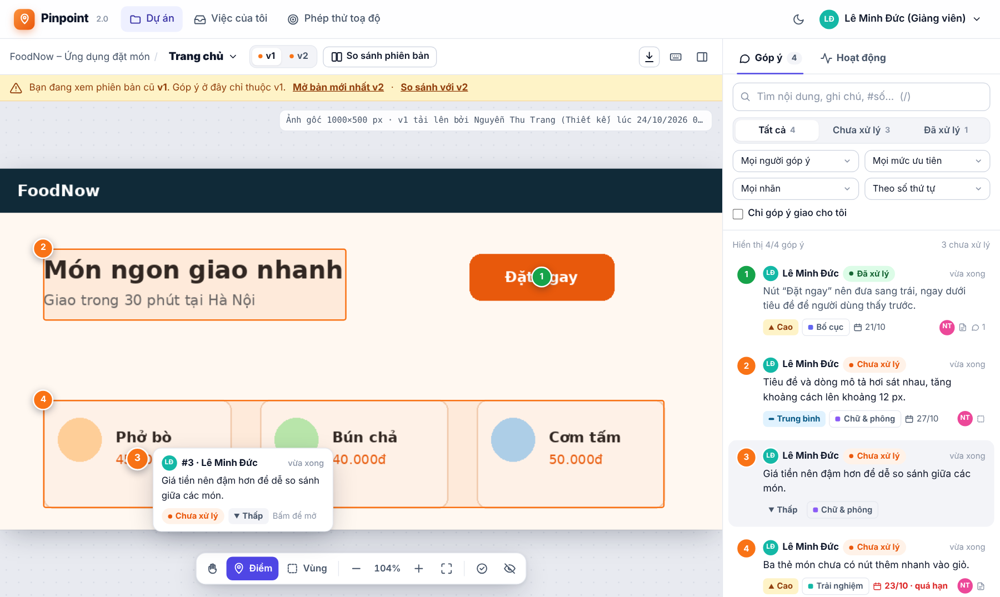

**Bản 2.0** làm lại giao diện theo phong cách các công cụ góp ý thiết kế phổ biến (Figma, Markup.io): ô soạn góp ý nổi ngay cạnh dấu,
mỗi góp ý có **ưu tiên, nhãn, người phụ trách, hạn và ghi chú xử lý**, thả cảm xúc, @nhắc tên, nhật ký hoạt động đầy đủ, so sánh
**thanh trượt / chồng mờ**, bảng tổng quan tiến độ, trang “Việc của tôi” và giao diện tối. **Bản 2.1** thêm thông báo khi được
@nhắc tên/giao việc, xoá ảnh tải nhầm, hồ sơ cá nhân, trang hỗ trợ khách hàng và trợ lý ảo trả lời câu hỏi về ứng dụng.
Xem [CHANGELOG](CHANGELOG.md).

## Chức năng

| # | Chức năng (theo đề tài) | Bổ sung ở bản 2.0 | Ở đâu |
|---|---|---|---|
| 1 | Tạo dự án, mời thành viên, cấp quyền **Chỉ xem / Góp ý / Quản lý**; tải ảnh PNG/JPEG và đặt tên từng màn hình | Bảng tổng quan (thống kê, tiến độ, hoạt động), sửa dự án, đổi tên màn hình, tải ảnh kéo thả | `projects.php`, `project.php` |
| 2 | Đặt **điểm** hoặc **vùng chữ nhật**, đánh số vị trí, chọn dấu để xem nhận xét | Ô soạn nổi cạnh dấu, thẻ xem nhanh khi rê chuột, ưu tiên/nhãn/phụ trách/hạn, phím tắt | `screen.php` |
| 3 | Trả lời từng nhận xét, sửa nội dung của mình, **đã xử lý / mở lại**, lọc theo trạng thái và người góp ý | **Ghi chú xử lý**, cảm xúc, @nhắc tên, lọc ưu tiên/nhãn/“giao cho tôi”, tìm kiếm, sắp xếp | `screen.php` |
| 4 | Tải phiên bản mới, giữ ảnh cũ cùng góp ý; **đặt hai phiên bản cạnh nhau**; ghi nhận phiên bản dùng để kiểm tra sau sửa | Chế độ **thanh trượt** và **chồng mờ** | `compare.php` |
| 5 | **Lưu lịch sử**, tìm góp ý chưa xử lý, **xuất CSV** gồm nội dung, vị trí, người viết, trạng thái, phiên bản | Nhật ký mọi thay đổi, “Việc của tôi”, lọc quá hạn, CSV 22 cột, in/PDF | `issues.php`, `inbox.php`, `export.php` |
| + | Tiện ích người dùng (bản 2.1) | Thông báo @nhắc tên / giao việc / trả lời, xoá ảnh tải nhầm, hồ sơ, hỗ trợ khách hàng, trợ lý ảo | `notifications.php`, `delete.php`, `profile.php`, `help.php` |

Hai yêu cầu kỹ thuật:

- **Toạ độ theo ảnh gốc:** dấu lưu bằng pixel của ảnh gốc. Màn hình ↔ ảnh được đổi qua *vùng nội dung* của ảnh, nên phóng to, thu nhỏ,
  đổi kích thước khung hay phần lề trống đều không làm lệch dấu (`public/assets/js/coords.js`, `src/Coordinates.php`).
  Trang `/calibration.php` kiểm tra điểm mẫu (750; 150) trên ảnh 1000×500 ở 4 kích thước hiển thị.
- **Góp ý gắn cố định với phiên bản ảnh:** bản mới là một hàng `image_versions` mới, dấu cũ không bị chuyển sang bản mới. Quyền được
  kiểm tra ở máy chủ cho mọi URL. Sửa nhận xét và đổi trạng thái dùng **khoá lạc quan** (`lock_version`), nên sửa từ bản cũ sẽ bị báo
  **xung đột** thay vì âm thầm ghi đè. Trả lời là thao tác thêm mới nên hai người trả lời cùng lúc không mất câu nào
  (`src/AnnotationRepository.php`).

## Chạy nhanh (Ubuntu/WSL)

```bash
sudo apt update
sudo apt install php-cli php-pgsql php-gd php-mbstring git postgresql postgresql-client nodejs
sudo service postgresql start
git clone <địa-chỉ-kho-của-nhóm> pinpoint
cd pinpoint/Ma_nguon
bash lab.sh db-config     # nhập CSDL/tài khoản riêng (tạo theo HUONG_DAN.md, mục 2)
bash lab.sh check
bash lab.sh setup         # tạo bảng + dữ liệu mẫu
bash lab.sh run           # mở http://127.0.0.1:8115
```

Đăng nhập bằng `designer@pinpoint.test`, `reviewer@pinpoint.test` hoặc `viewer@pinpoint.test`. Mật khẩu của cả ba là `Pinpoint@123`.

Kiểm thử (mở terminal thứ hai):

```bash
bash lab.sh test          # đơn vị + JS + tích hợp PostgreSQL + HTTP → KET_QUA=TAT_CA_DAT
npm install && npx playwright install chromium
bash lab.sh e2e           # trình duyệt thật: 2 tình huống + phép thử 1 (máy chủ phải đang chạy)
```

## Ảnh giao diện

| | |
|---|---|
| 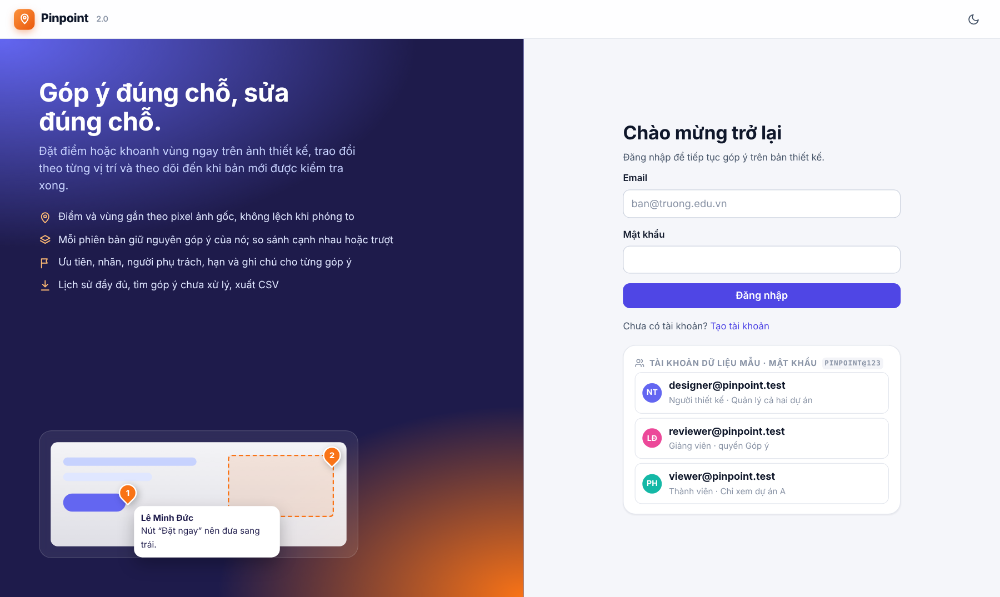 | 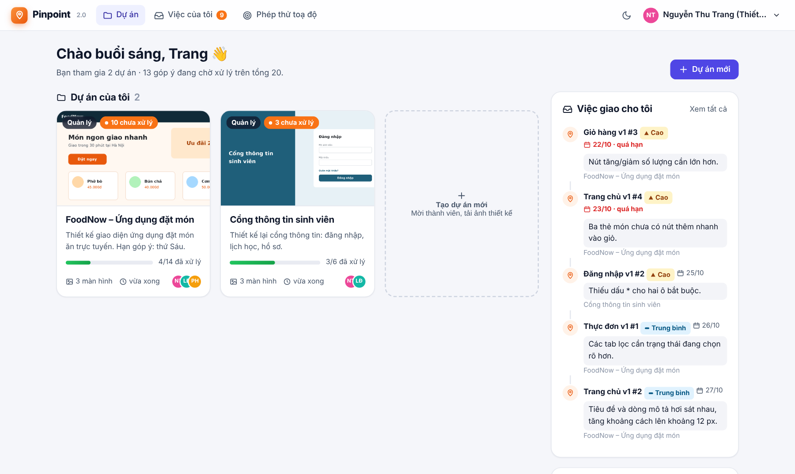 |
| 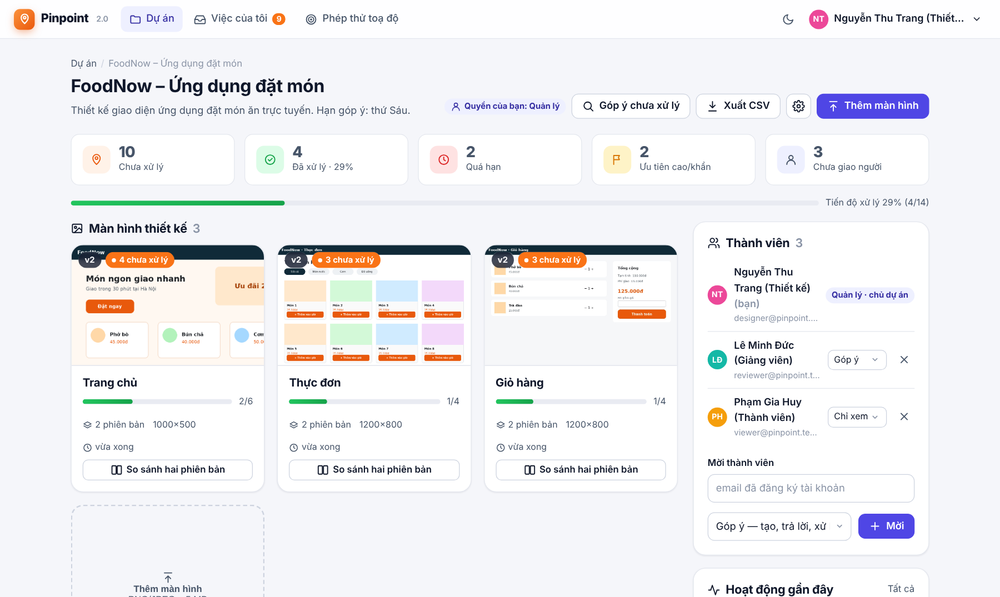 | 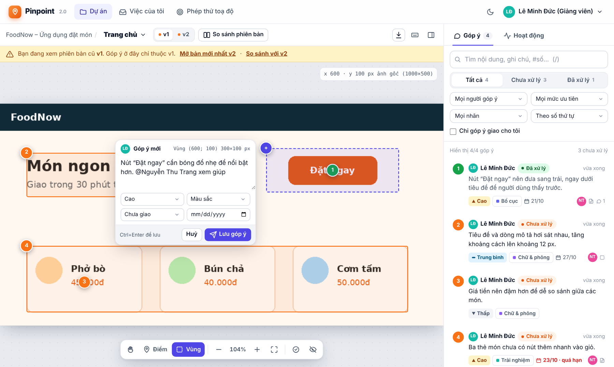 |
| 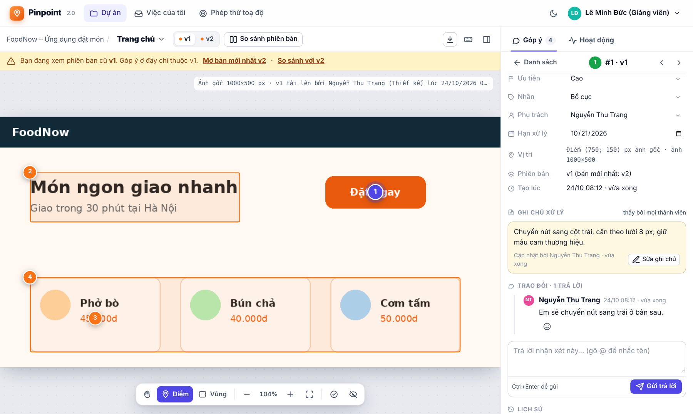 | 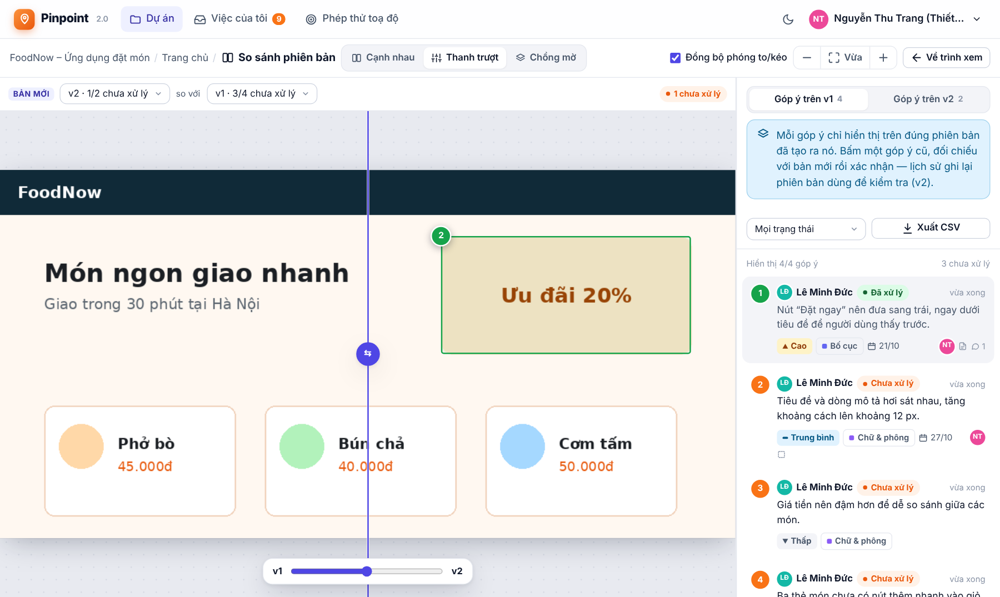 |
| 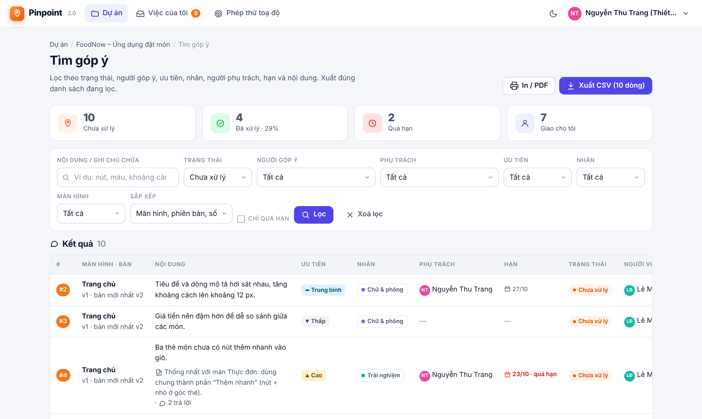 | 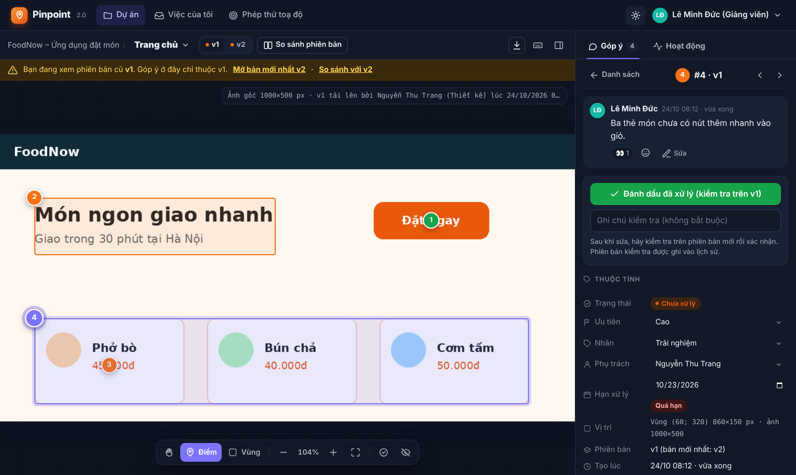 |
| 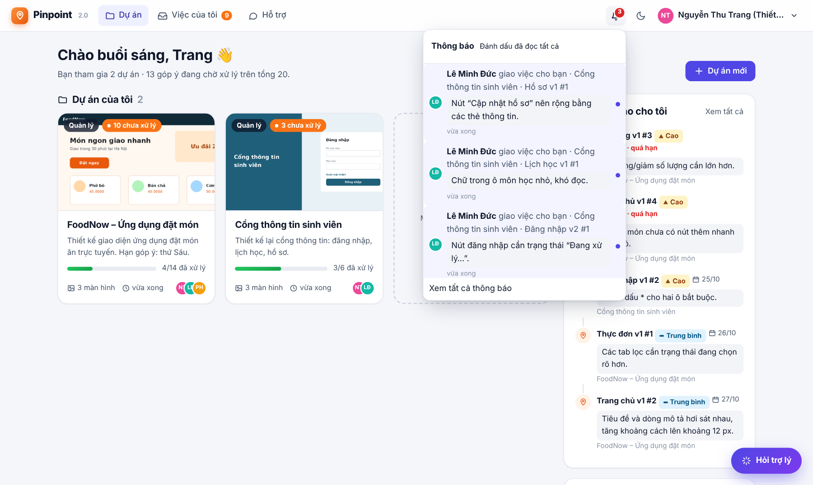 | 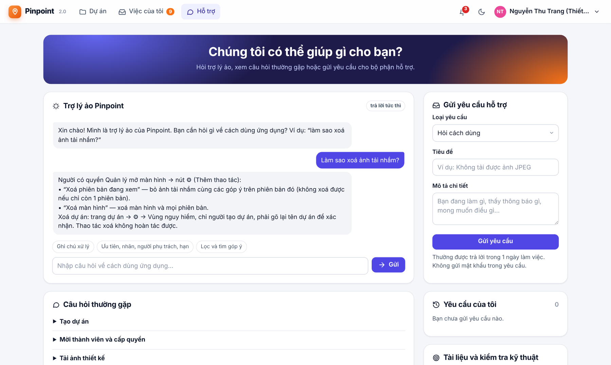 |

## Tài liệu

| Tệp | Nội dung |
|---|---|
| [HUONG_DAN.md](HUONG_DAN.md) | Cài đặt chi tiết, tạo CSDL, kịch bản trình diễn 2 tình huống, lỗi thường gặp |
| [docs/THIET_KE.md](docs/THIET_KE.md) | Thực thể, quan hệ, ERD, kiến trúc, phân quyền, API |
| [docs/DU_LIEU_MAU.md](docs/DU_LIEU_MAU.md) | 2 dự án, 3 tài khoản, 12 ảnh, 20 góp ý và **đáp án** các phép thử |
| [docs/KIEM_THU.md](docs/KIEM_THU.md) | Danh sách ca kiểm thử, kết quả, lỗi đã sửa và kiểm tra lại |
| [NGUON_SU_DUNG.md](NGUON_SU_DUNG.md) | Thư viện, công cụ, tài nguyên và giấy phép |
| [docs/QUAN_LY_DU_AN.md](docs/QUAN_LY_DU_AN.md) | Milestone, issue, quy trình review gợi ý |
| [CONTRIBUTING.md](CONTRIBUTING.md) · [CODE_OF_CONDUCT.md](CODE_OF_CONDUCT.md) · [SECURITY.md](SECURITY.md) · [CHANGELOG.md](CHANGELOG.md) | Quy trình đóng góp, quy tắc ứng xử, bảo mật, lịch sử phiên bản |
| `Bao_cao.docx` | Báo cáo bài tập lớn |

## Cấu trúc

```
Ma_nguon/
├── lab.sh                 check | db-config | setup | run | test | e2e | sql | reset
├── database/              schema.sql, seed-data.php (dữ liệu có đáp án), fixtures/ (12 ảnh)
├── public/                trang web (document root): login, projects, project, screen, compare, issues, export, api, image, calibration
│   ├── inbox.php, project_edit.php   Việc của tôi; sửa dự án / đổi tên màn hình (bản 2.0)
│   ├── notifications.php, delete.php, profile.php, help.php   Thông báo, xoá, hồ sơ, hỗ trợ (bản 2.1)
│   └── assets/js/         coords.js (toạ độ), annotator.js (khung ảnh), thread.js (bảng góp ý), screen.js, compare.js, ui.js, theme-init.js
├── src/                   Database, Access (quyền), Coordinates, ImageStore, *Repository, Export, Seeder, View (hiển thị dùng chung), NotificationRepository, SupportRepository, Assistant (trợ lý ảo)
├── templates/             header.php, footer.php
├── tests/                 run.php, js/, integration.php, http.php, e2e/browser.mjs
└── tools/                 db-config, db-check, setup, reset, sql, make_fixtures.py
```

## Nhóm thực hiện

| Thành viên | MSSV | Phụ trách chính |
|---|---|---|
| Ngô Văn Ngọc (nhóm trưởng) | 1871020425 | CSDL, phân quyền, dự án/thành viên, tải ảnh và phiên bản (`schema.sql`, `Access`, `ProjectRepository`, `ScreenRepository`, `ImageStore`) |
| Trần Văn Quý | 1871020489 | Trình xem và toạ độ, so sánh hai phiên bản (`coords.js`, `annotator.js`, `screen.js`, `compare.js`, `calibration.php`) |
| Khổng Minh Hiếu | 1871020230 | Góp ý, trả lời, trạng thái, xung đột, tìm kiếm và xuất CSV, kiểm thử và CI (`AnnotationRepository`, `Export`, `tests/`, `.github/`) |
