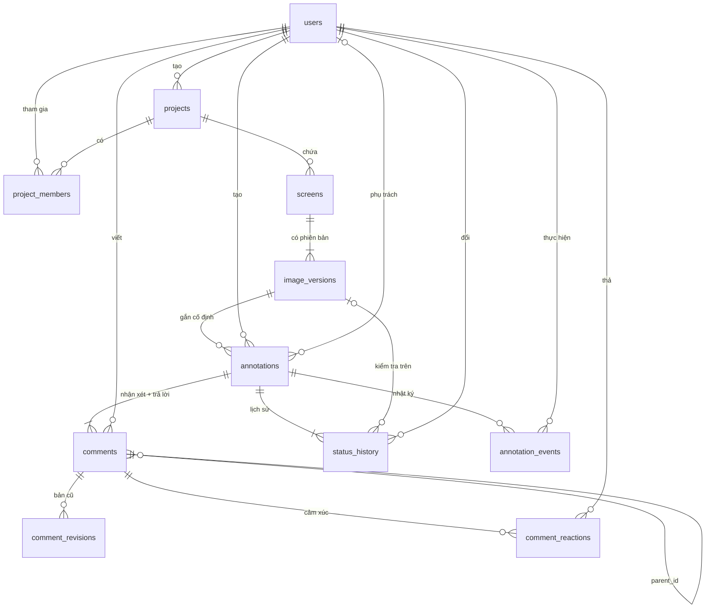
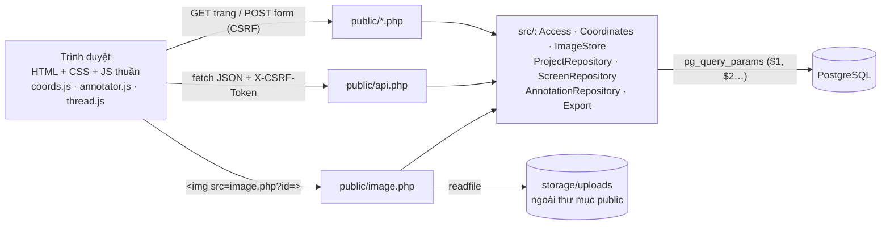

# Thiết kế hệ thống Pinpoint

## 1. Tác nhân và quyền

| Tác nhân | Quyền trong dự án | Được làm |
|---|---|---|
| Người thiết kế | **ADMIN** (Quản lý) | Mọi việc của COMMENT; tạo/đổi tên màn hình; tải phiên bản ảnh; mời, đổi quyền, xoá thành viên |
| Giảng viên / người duyệt | **COMMENT** (Góp ý) | Xem; đặt điểm/vùng; nhận xét, trả lời; sửa nội dung của mình; đánh dấu đã xử lý / mở lại |
| Thành viên được cấp quyền xem | **VIEW** (Chỉ xem) | Xem ảnh, góp ý, lịch sử; tìm và xuất danh sách |
| Người ngoài dự án | — | Không thấy gì; mọi URL tới ảnh/nhận xét của dự án trả **404** |

Người tạo dự án luôn giữ quyền ADMIN. Quyền được kiểm tra ở máy chủ trong `src/Access.php` (`Access::require`). Mỗi đối tượng con
(màn hình, phiên bản, dấu, nhận xét) được truy ngược về dự án trước khi kiểm tra quyền.

## 2. Thực thể và quan hệ

| Thực thể | Bảng | Ghi chú |
|---|---|---|
| User | `users` | email duy nhất (viết thường), mật khẩu băm `password_hash` |
| Project | `projects` | `created_by` → users (1–N) |
| ProjectMember / Role | `project_members` | bảng trung gian N–N users ↔ projects, `role ∈ {VIEW, COMMENT, ADMIN}`, khoá chính (project_id, user_id) |
| Screen | `screens` | thuộc một dự án; tên duy nhất trong dự án |
| ImageVersion | `image_versions` | thuộc một màn hình; `version_no` tăng dần, UNIQUE(screen_id, version_no); lưu width/height ảnh gốc, mime, sha256 |
| Annotation | `annotations` | thuộc **một** phiên bản ảnh; `seq_no` duy nhất trong phiên bản; `shape ∈ {POINT, RECT}`; x, y, w, h theo **pixel ảnh gốc**; `status`; `lock_version` |
| Comment / Reply | `comments` | nhận xét gốc (`parent_id IS NULL`, đúng 1 cho mỗi dấu: chỉ mục duy nhất có điều kiện) và trả lời (`parent_id` → nhận xét gốc) |
| (lịch sử sửa) | `comment_revisions` | lưu nội dung cũ mỗi lần sửa |
| StatusHistory | `status_history` | from → to, người đổi, `checked_version_id` = phiên bản dùng để kiểm tra, ghi chú |
| (thuộc tính, bản 2.0) | cột mới của `annotations` | `priority ∈ {LOW, MEDIUM, HIGH, URGENT}`, `category ∈ {LAYOUT, COLOR, TYPO, CONTENT, UX, A11Y, OTHER}`, `assignee_id` → users (phải là thành viên dự án), `due_date`, **`note`** (ghi chú xử lý ≤ 4000 ký tự) + `note_updated_by/at` |
| Reaction (bản 2.0) | `comment_reactions` | cảm xúc trên nhận xét/trả lời; khoá chính (comment_id, user_id, kind), `kind ∈ {LIKE, HEART, PARTY, EYES}` |
| Notification (bản 2.1) | `notifications` | người nhận, người thực hiện, `kind ∈ {MENTION, ASSIGNED, REPLY, STATUS}`, góp ý liên quan, trích nội dung, `read_at` |
| SupportTicket (bản 2.1) | `support_tickets` | yêu cầu hỗ trợ: loại, tiêu đề, nội dung, `status ∈ {OPEN, ANSWERED, CLOSED}`, trả lời |
| ActivityEvent (bản 2.0) | `annotation_events` | nhật ký mọi thay đổi: `kind ∈ {CREATED, REPLIED, EDITED, STATUS, PRIORITY, CATEGORY, ASSIGNEE, DUE, NOTE}`, giá trị cũ/mới, chi tiết, người làm, thời điểm |

Quan hệ 1–1 theo nghiệp vụ: mỗi Annotation có đúng một nhận xét gốc. Mỗi Screen có một phiên bản mới nhất, là phiên bản có `version_no` lớn nhất.



Nâng cấp CSDL từ bản 1.0: các cột và bảng mới dùng `ADD COLUMN IF NOT EXISTS` / `CREATE TABLE IF NOT EXISTS`, nên chạy lại
`bash lab.sh setup` là đủ (dữ liệu cũ giữ nguyên, nhận mặc định *Trung bình* / *Khác*).

Ràng buộc quan trọng trong `database/schema.sql`:

- `CHECK ((shape='POINT' AND w IS NULL AND h IS NULL) OR (shape='RECT' AND w>0 AND h>0))`: kiểu dấu phải khớp với kích thước.
- `UNIQUE(image_version_id, seq_no)` và `UNIQUE(screen_id, version_no)`: không trùng số dù nhiều người thao tác cùng lúc.
  Khi tạo mới, ứng dụng còn khoá hàng cha bằng `SELECT … FOR UPDATE`.
- Khoá ngoại có `ON DELETE CASCADE` theo cây dự án → màn hình → phiên bản → dấu → nhận xét/lịch sử.

## 3. Yêu cầu kỹ thuật 1 — toạ độ theo ảnh gốc

```
Khung hiển thị (boxW × boxH)            Ảnh gốc (W × H)
┌──────────────────────────────┐
│   lề trống                   │        scale = min(boxW/W, boxH/H) × zoom
│   ┌──────────────────────┐   │        left  = (boxW − W·scale)/2 + panX
│   │  vùng nội dung ảnh   │   │        top   = (boxH − H·scale)/2 + panY
│   └──────────────────────┘   │
│   lề trống                   │        ảnh → màn hình:  sx = left + x·scale ;  sy = top + y·scale
└──────────────────────────────┘        màn hình → ảnh:  x = (sx − left)/scale ; y = (sy − top)/scale
```

- Mọi phép đổi đi qua **vùng nội dung** (left, top, scale), không đi qua khung. Vì vậy lề trống không bao giờ bị tính vào toạ độ.
  Bấm vào lề cho ra x hoặc y nằm ngoài [0, W] × [0, H] và bị từ chối.
- Ví dụ đáp án: ảnh 1000×500 hiển thị 500×250 → scale 0,5 → điểm (750; 150) ở (375; 75).
- Khi khung đổi kích thước, `ResizeObserver` gọi lại `layout()`. Dấu được vẽ lại từ toạ độ ảnh gốc, không cộng dồn sai số.
- Phóng to quanh con trỏ (`zoomAround`): điểm ảnh nằm dưới con trỏ giữ nguyên vị trí trên màn hình.
- Máy chủ kiểm tra lại toạ độ theo kích thước của **đúng phiên bản** đó (`Coordinates::validate`): điểm/vùng phải nằm trong ảnh, vùng ≥ 2 px.

## 4. Yêu cầu kỹ thuật 2 — phiên bản, quyền, cập nhật đồng thời

| Vấn đề | Cách giải quyết |
|---|---|
| Bản mới không được chuyển dấu cũ sang | Tải ảnh chỉ thêm hàng `image_versions` mới (`ScreenRepository::addVersion`), không sửa hàng cũ. Dấu tham chiếu `image_version_id` nên luôn thuộc ảnh cũ. Tệp ảnh cũ được giữ nguyên |
| Hai người trả lời cùng lúc | Mỗi trả lời là một lệnh `INSERT` độc lập, không đọc-sửa-ghi, nên không có câu nào bị mất |
| Sửa nhận xét từ bản đã cũ | Khoá lạc quan: máy khách gửi `lock_version` đã đọc. Máy chủ khoá hàng (`FOR UPDATE`), so sánh và trả **409 CONFLICT** kèm nội dung hiện tại nếu không khớp. Không bao giờ ghi đè âm thầm |
| Đổi trạng thái cùng lúc | Cũng dùng `lock_version` của annotation. Mỗi lần đổi ghi một dòng `status_history` trong cùng giao dịch |
| Ghi nhận kiểm tra sau sửa | `status_history.checked_version_id`: ví dụ “đã xử lý — kiểm tra trên v2”. Phiên bản này phải thuộc cùng màn hình |
| Truy cập chéo dự án bằng URL | `image.php`, `api.php`, `screen.php`, `compare.php`, `export.php` đều tìm dự án sở hữu đối tượng rồi gọi `Access::require`. Người không phải thành viên nhận 404 |

## 5. Kiến trúc



- **Không framework, không bước build.** Mỗi trang PHP tự nạp `src/web.php` (phiên, CSRF, header bảo mật, xử lý lỗi).
- **Truy vấn có tham số** bằng `pg_query_params`, giống Lab05. Thao tác nhiều bước chạy trong `transaction()`.
- **Bảo mật:** escape mọi đầu ra bằng `e()` (PHP) và `textContent` (JS). CSP `script-src 'self'` chặn script nhúng.
  Mọi POST đều kiểm tra CSRF. Ảnh lưu ngoài `public/` với tên ngẫu nhiên, kiểm tra loại bằng nội dung tệp, giới hạn 5 MB và 16–8000 px.
  Ô CSV bắt đầu bằng `= + - @` được thêm dấu nháy để Excel không hiểu là công thức. Mật khẩu được băm và phiên được tạo lại khi đăng nhập.

## 6. Trang và API

| URL | Quyền tối thiểu | Mục đích |
|---|---|---|
| `/login.php`, `/register.php`, `/logout.php` | — | Đăng nhập, tạo tài khoản, đăng xuất |
| `/projects.php` (GET/POST) | đăng nhập | Danh sách dự án của tôi; tạo dự án |
| `/project.php?id=` | VIEW | Bảng tổng quan: thống kê, tiến độ, màn hình, thành viên, hoạt động gần đây |
| `/project_edit.php` (POST) | ADMIN | Sửa tên/mô tả dự án; đổi tên màn hình |
| `/notifications.php` (GET/POST) | đăng nhập | Thông báo của tôi; đánh dấu đã đọc |
| `/profile.php` (GET/POST) | đăng nhập | Hồ sơ: đổi tên, chức danh, mật khẩu (cần mật khẩu hiện tại) |
| `/help.php` (GET/POST) | đăng nhập | Hỗ trợ khách hàng: trợ lý ảo, câu hỏi thường gặp, gửi/đóng yêu cầu của mình |
| `/delete.php` (POST) | ADMIN (dự án: chỉ người tạo + gõ lại tên) | Xoá phiên bản ảnh tải nhầm, xoá màn hình, xoá dự án |
| `/inbox.php` | đăng nhập | Việc của tôi: góp ý chưa xử lý được giao cho tôi, nhóm theo quá hạn / sắp đến hạn |
| `/members.php` (POST) | ADMIN | Thêm / đổi quyền / xoá thành viên |
| `/screen_new.php`, `/version_new.php` (POST) | ADMIN | Tạo màn hình kèm v1; tải phiên bản mới |
| `/screen.php?id=&v=&a=` | VIEW | Trình xem một phiên bản (COMMENT mới có công cụ) |
| `/compare.php?screen=&left=&right=&mode=side\|swipe\|onion` | VIEW | Hai phiên bản cạnh nhau, thanh trượt hoặc chồng mờ |
| `/issues.php?project=&status=&author=&screen=&q=&priority=&category=&assignee=&overdue=&sort=` | VIEW | Tìm góp ý (nội dung + ghi chú), thống kê, nhật ký hoạt động, in/PDF |
| `/export.php?…` | VIEW | Xuất CSV theo bộ lọc |
| `/image.php?id=` | VIEW | Phát ảnh sau khi kiểm tra quyền |
| `/api.php?action=list&version=` (GET) | VIEW | Danh sách góp ý của một phiên bản (JSON) |
| `/api.php?action=activity&project=&screen=` (GET) | VIEW | Nhật ký hoạt động (40 thay đổi mới nhất) |
| `/api.php` `create` · `reply` · `edit` · `status` (POST) | COMMENT | Tạo dấu + nhận xét (kèm ưu tiên, nhãn, người phụ trách, hạn); trả lời; sửa (`lock_version`); đổi trạng thái (`lock_version`, `checked_version_id`) |
| `/api.php?action=notifications` (GET), `notif_read` · `chat` (POST) | đăng nhập | Thông báo + số chưa đọc; đánh dấu đã đọc; hỏi trợ lý ảo |
| `/api.php` `update` · `react` (POST) | COMMENT | Sửa thuộc tính/ghi chú (`lock_version`, chung khoá với trạng thái → CONFLICT kèm giá trị hiện tại); bật/tắt cảm xúc |
| `/calibration.php` | — | Phép thử 1 trực quan |

Mã lỗi API: `UNAUTHENTICATED` (401), `FORBIDDEN` (403), `NOT_FOUND` (404), `CONFLICT` (409), `POSITION_OUTSIDE_IMAGE`, `RECT_TOO_SMALL`,
`BODY_INVALID`, `STATUS_UNCHANGED`, `CHECKED_VERSION_INVALID`, `PRIORITY_INVALID`, `CATEGORY_INVALID`, `ASSIGNEE_NOT_MEMBER`,
`DUE_DATE_INVALID`, `NOTE_TOO_LONG`, `REACTION_INVALID`, `LAST_VERSION`, `CONFIRM_MISMATCH`, `PASSWORD_WRONG`, `TICKET_INVALID`,
`CHAT_INVALID` (422), `OWNER_ONLY` (403).

Quy tắc thông báo: người thực hiện không tự nhận thông báo; người nhận phải còn là thành viên dự án; một thao tác gửi tối đa một
thông báo cho mỗi người (ví dụ vừa được giao vừa được nhắc tên chỉ nhận thông báo “giao việc”). Thông báo được ghi trong cùng giao
dịch với thao tác gốc, nên thao tác lỗi thì cũng không có thông báo.

## 7. Giao diện (bản 2.0)

| Khu vực | Thiết kế | Lý do |
|---|---|---|
| Hệ thiết kế | `app.css` dùng biến màu (sáng/tối), phông hệ thống, biểu tượng SVG tự vẽ (`src/View.php`) | Không tải tài nguyên ngoài, tương thích CSP `default-src 'self'` |
| Trình xem | Khung ảnh nền chấm + **thanh công cụ nổi** (Chọn/kéo, Điểm, Vùng, phóng to, ẩn dấu, ẩn đã xử lý); thẻ xem nhanh khi rê chuột; toạ độ con trỏ theo px ảnh gốc | Giống Figma/Markup.io: công cụ gần nội dung, ít di chuyển chuột |
| Tạo góp ý | **Ô soạn nổi ngay cạnh dấu** (ưu tiên, nhãn, người phụ trách, hạn), `Ctrl+Enter` lưu, `@` nhắc tên | Người duyệt không phải rời mắt khỏi chỗ đang góp ý |
| Bảng góp ý | Tab *Góp ý / Hoạt động*; tìm kiếm, lọc trạng thái dạng phân đoạn có đếm, lọc người góp ý/ưu tiên/nhãn/“giao cho tôi”, sắp xếp; thẻ có ảnh đại diện, nhãn, hạn | Lọc tức thì phía trình duyệt cho một phiên bản |
| Chi tiết góp ý | Nút trạng thái lớn ghi rõ phiên bản kiểm tra; khối **Thuộc tính**; khối **Ghi chú xử lý**; trao đổi có cảm xúc; dòng thời gian lịch sử | Gom mọi thứ cần để xử lý một góp ý vào một chỗ |
| So sánh | 3 chế độ: cạnh nhau, **thanh trượt**, **chồng mờ**; phím 1/2/3 | Thấy ngay chỗ đã sửa giữa hai phiên bản |
| Tổng quan | Thẻ thống kê bấm được (chưa xử lý, đã xử lý, quá hạn, ưu tiên cao, chưa giao), thanh tiến độ, hoạt động gần đây, “Việc của tôi” | Quản lý dự án nhìn được tiến độ |

Phím tắt trình xem: `C`/`P` điểm, `R` vùng, `V`/`H` kéo, `+ − 0` phóng, `←/→` góp ý trước/sau, `M` ẩn dấu, `/` tìm, `\` ẩn bảng, `?` trợ giúp, `Esc`.
